<div align="center">
  

  # 🚨 Crisis Match — Sahayak Setu

  **Offline-first emergency response system that connects victims to the nearest responders — even without internet.**

  [](https://flutter.dev)
  [](https://supabase.com)
  [](https://firebase.google.com)
  [](https://polygon.technology)

  > 🏆 Built at **HackIndia Spark 6 @ NIT Delhi** by **Team Routers**
</div>

---

## 📋 Table of Contents

- [⚡ Problem Statement](#-problem-statement)
- [💡 Solution](#-solution)
- [🧩 Core Features](#-core-features)
- [📱 Application Screens](#-application-screens)
- [🏗️ Tech Stack](#️-tech-stack)
- [🧠 Engineering Highlights](#-engineering-highlights)
- [⚙️ Setup & Installation](#️-setup--installation)
- [🔐 Security](#-security)
- [👨‍💻 Team Routers](#-team-routers)

---

## ⚡ Problem Statement

In real emergencies, **help exists — but coordination fails**.

| Real-World Crisis | The Gap |
|---|---|
| Kerala Floods (2018) | Boats were available, but victims were unreachable |
| Punjab Floods (2023) | Rescue delays despite resources being present |

**Existing systems fail because of:**

| Issue | Impact |
|---|---|
| ❌ Internet dependency | Systems go dark when networks are overloaded |
| ❌ Centralized bottlenecks | 112/911 lines get overwhelmed |
| ❌ No real-time routing | Helpers can't find victims efficiently |
| ❌ Poor distress accessibility | Injured users can't operate complex UIs |

---

## 💡 Solution

**Crisis Match** is a **decentralized emergency orchestration platform** that bridges the gap between victims and helpers — online or offline.

| Capability | Detail |
|---|---|
| 📡 Offline-first | Works via SMS fallback when internet fails |
| 🧭 Smart Matching | Connects victims to the nearest verified helper |
| 🎙️ Hands-free SOS | Voice-triggered emergency without touching the screen |
| 🔗 Blockchain Trust | Rescue actions logged immutably for accountability |

---

## 🧩 Core Features

<details>
<summary><b>🚨 Offline SOS — Zero Connectivity Mode</b></summary>

- Automatically detects network failure
- Sends **GPS coordinates + priority level via SMS**
- Guaranteed delivery using native telephony — no app server needed
</details>

<details>
<summary><b>🗺️ Smart Routing Engine</b></summary>

- Matches victim ↔ nearest available helper in real time
- Powered by **PostGIS** geo queries for spatial accuracy
- Considers priority scoring + wait-time logic for fair dispatch
</details>

<details>
<summary><b>🎙️ Voice-Activated Emergency</b></summary>

- Trigger SOS without touching the phone
- Real-time **Speech-to-Text** pipeline with continuous listening
- Proper STT lifecycle management to prevent battery drain
</details>

<details>
<summary><b>👥 Tri-Portal Ecosystem</b></summary>

| Portal | Role |
|---|---|
| 👤 **Victim App** | Trigger SOS, track incoming help |
| 🧑‍🚒 **Helper App** | Accept incidents & navigate to victims |
| 🛠️ **Admin Dashboard** | Monitor system-wide activity |
</details>

<details>
<summary><b>🔗 Blockchain Trust Layer</b></summary>

- Every rescue event is stored **immutably on Polygon Amoy**
- Builds a **verifiable reputation system** for responders
- Prevents fraudulent rescue claims
</details>

---

## 📱 Application Screens

### 👤 Victim Portal

<p align="center">
  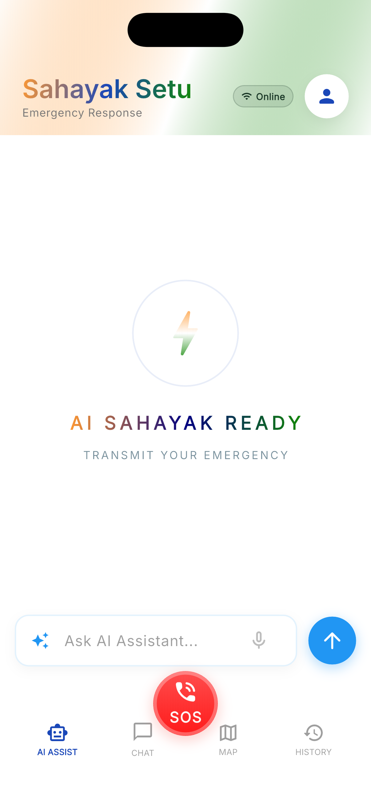
  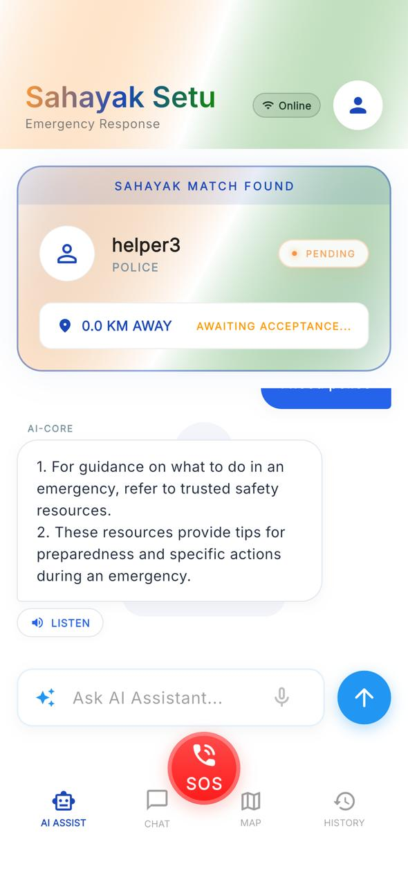
  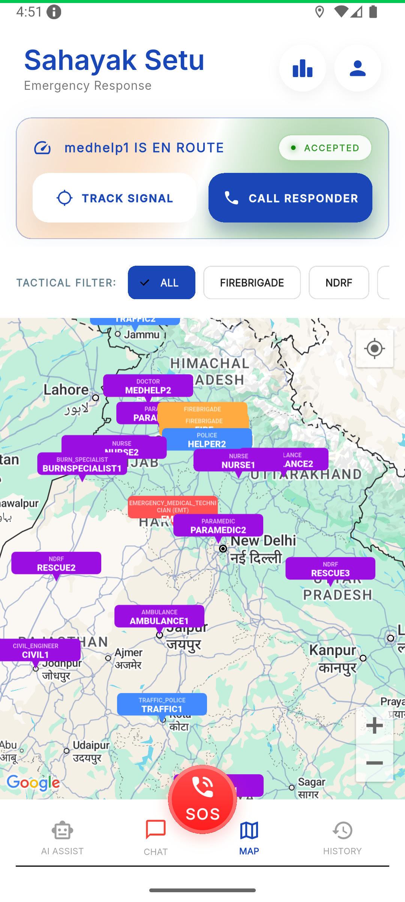
  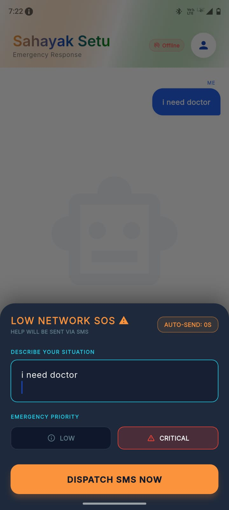
</p>

### 🧑‍🚒 Helper Portal

<p align="center">
  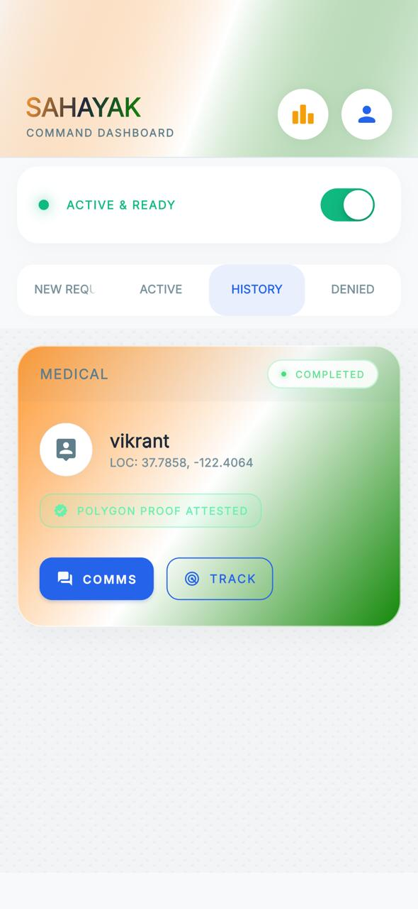
  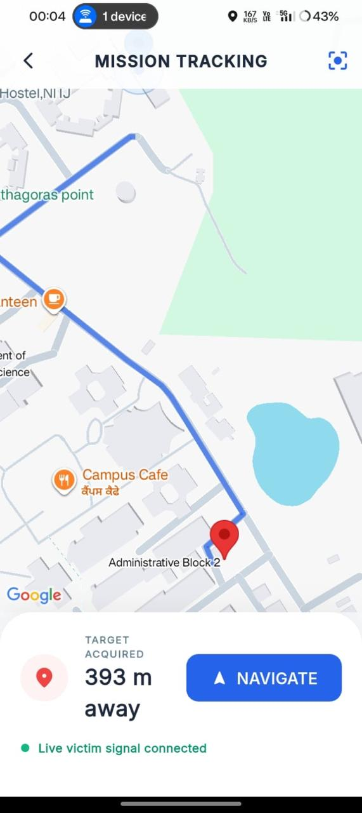
  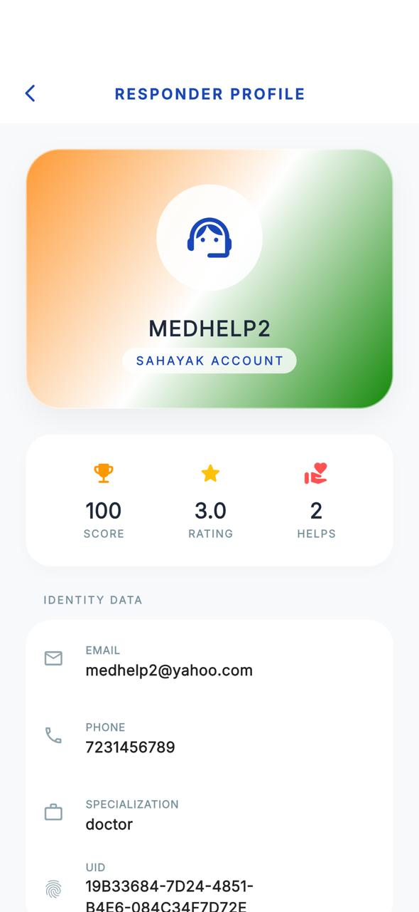
  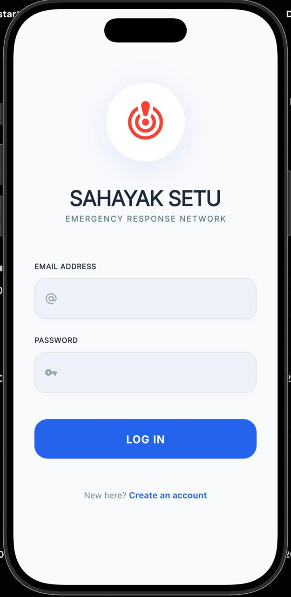
</p>

### 🛠️ Admin Dashboard

<p align="center">
  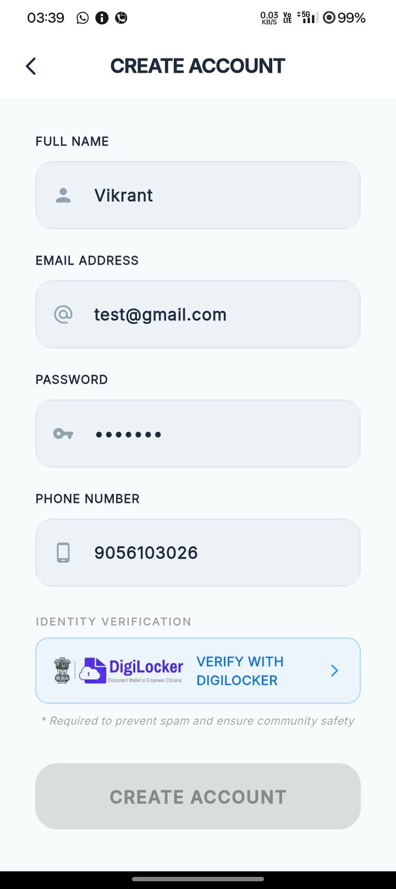
  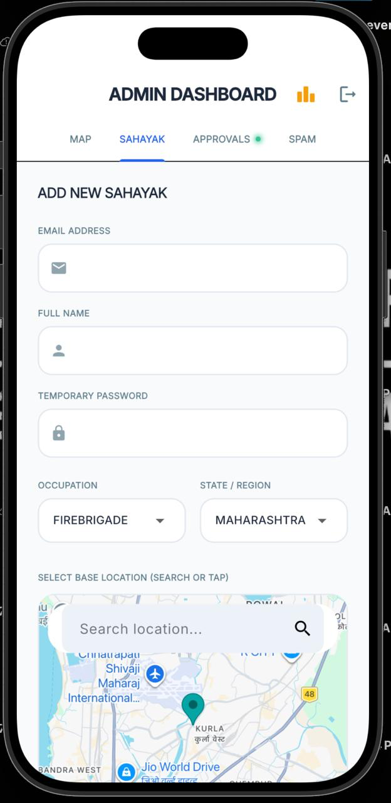
  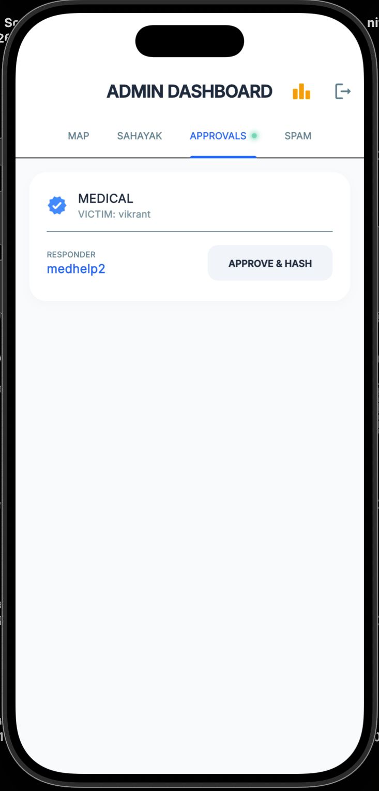
  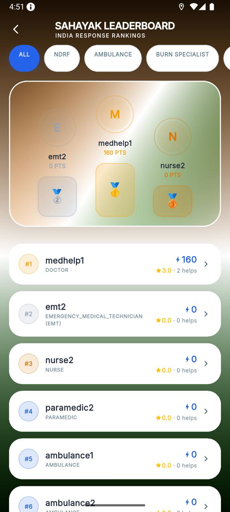
</p>

---

## 🏗️ Tech Stack

| Layer | Technology |
|---|---|
| 📱 **Frontend** | Flutter (Dart), BLoC State Management |
| ⚙️ **Backend** | Supabase (PostgreSQL + Auth + Row-Level Security) |
| 🌍 **Maps & Location** | Google Maps SDK, PostGIS |
| 📡 **Communication** | SMS Telephony API, Firebase Cloud Messaging (FCM) |
| 🤖 **AI & Automation** | FastAPI, LangChain, Self-RAG, n8n |
| 🎤 **Voice** | Speech-to-Text pipeline |
| 🔗 **Blockchain** | Polygon Amoy (rescue logging) |

### Key Dependencies (`pubspec.yaml`)

```yaml
supabase_flutter: ^2.8.0     # Backend & auth
flutter_bloc: ^9.1.0          # State management
google_maps_flutter: ^2.16.0  # Maps & routing
speech_to_text: ^7.3.0        # Voice SOS
firebase_messaging: ^15.2.10  # Push notifications
telephony: ^0.2.0             # Offline SMS SOS
connectivity_plus: ^6.1.0     # Network detection
flutter_foreground_task: ^8.12.0  # Background services
```

---

## 🧠 Engineering Highlights

- 🔥 **Offline-first architecture** — full functionality degrades gracefully without internet
- ⚡ **Real-time geo-matching** — spatial queries via PostGIS for sub-second victim-helper pairing
- 🎤 **Continuous STT** — proper lifecycle management prevents memory leaks and battery drain
- 🔄 **Background execution** — OS-level foreground task handling across Android restrictions
- 🌐 **Flutter ↔ WebGL bridge** — Kotlin Method Channels for native Android integration
- 🤖 **Self-RAG AI pipeline** — context-aware retrieval for intelligent emergency guidance

---

## ⚙️ Setup & Installation

### Prerequisites

- Flutter SDK `^3.11.3`
- Dart SDK `^3.11.3`
- Android Studio / Xcode (for mobile builds)
- Supabase account
- Firebase project with FCM enabled
- Google Maps API key

### Steps

```bash
# 1. Clone the repository
git clone https://github.com/vikrant-sainii/crisis_match.git
cd crisis_match

# 2. Install dependencies
flutter pub get

# 3. Configure environment variables
cp .env.example .env
# Fill in your keys in .env
```

### Environment Variables (`.env`)

```env
SUPABASE_URL=your_supabase_url
SUPABASE_ANON_KEY=your_supabase_anon_key
GOOGLE_MAPS_API_KEY=your_google_maps_api_key
```

### Run the App

```bash
# Debug mode
flutter run

# Release build (Android)
flutter build apk --release

# Release build (iOS)
flutter build ios --release
```

---

## 🔐 Security

| Measure | Implementation |
|---|---|
| 🔑 API Key Management | Environment-based via `.env` (never hardcoded) |
| 🛡️ Database Security | Supabase Row-Level Security (RLS) policies |
| 📲 Runtime Permissions | Mic, Location & SMS requested at runtime |
| 🔗 Blockchain Audit | Immutable rescue logs on Polygon Amoy |

> **Note:** Never commit your `.env` file. It is listed in `.gitignore` by default.

---

## 👨‍💻 Team Routers

<table>
  <tr>
    <td align="center"><b>Vikrant Saini</b></td>
    <td>Flutter app development (UI + BLoC state management)<br/>Native Android integration via Kotlin Method Channels<br/>Supabase integration (auth, database, APIs)</td>
  </tr>
  <tr>
    <td align="center"><b>Prathamesh Patil</b></td>
    <td>AI pipeline development (LangChain + Self-RAG)<br/>Workflow orchestration using n8n<br/>Blockchain integration (Polygon — rescue logging & trust layer)</td>
  </tr>
  <tr>
    <td align="center"><b>Abhishek Sapkal</b></td>
    <td>Repository management & GitHub collaboration<br/>Supabase support & system integration<br/>Product thinking, research & presentation strategy</td>
  </tr>
</table>

---

<div align="center">
  <i>Built with ❤️ for communities that need help the most.</i>
</div>
